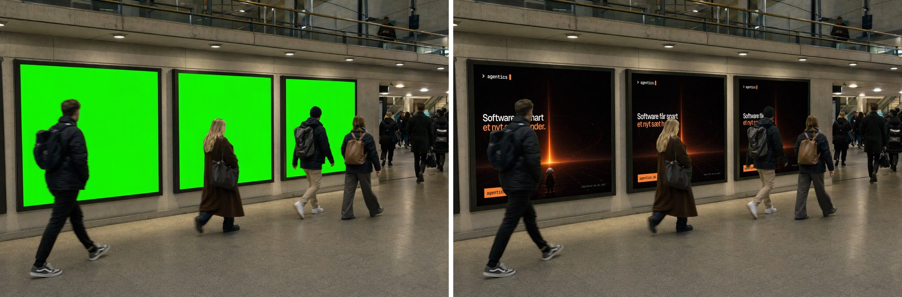
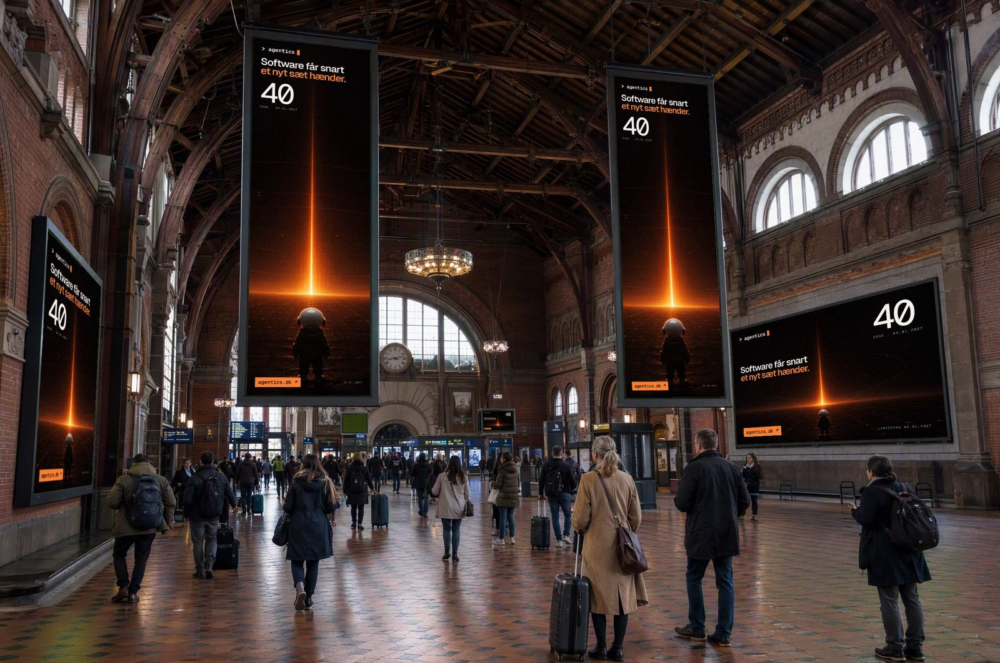
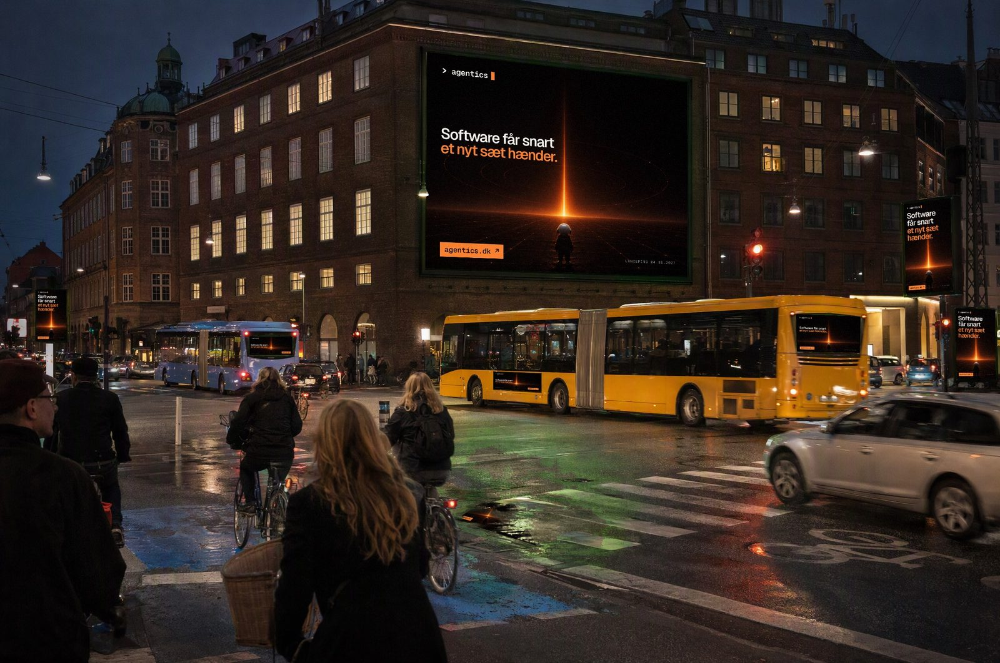
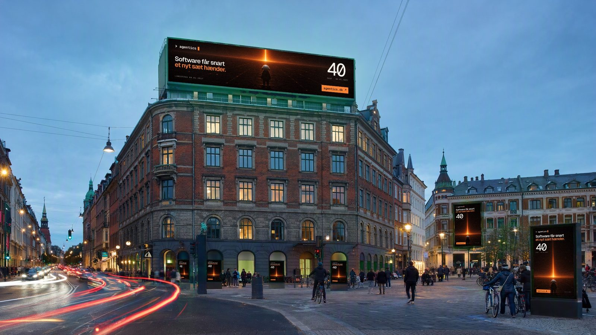
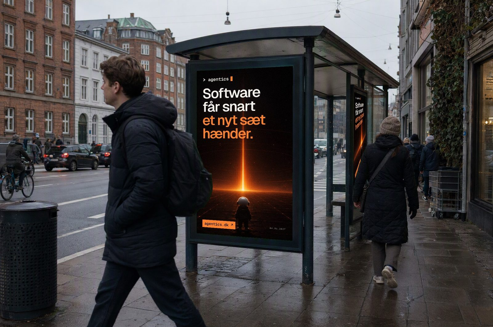
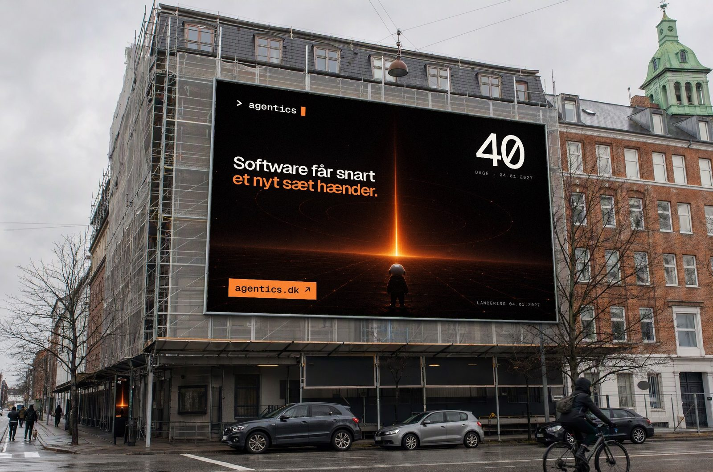
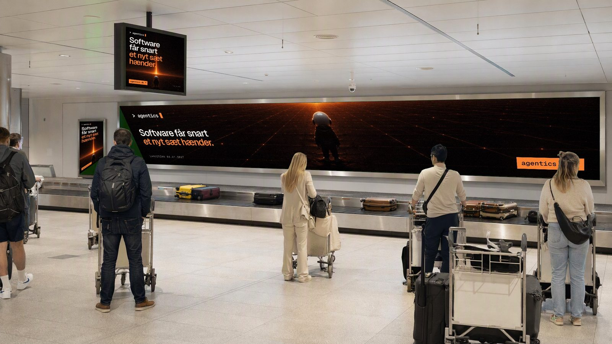
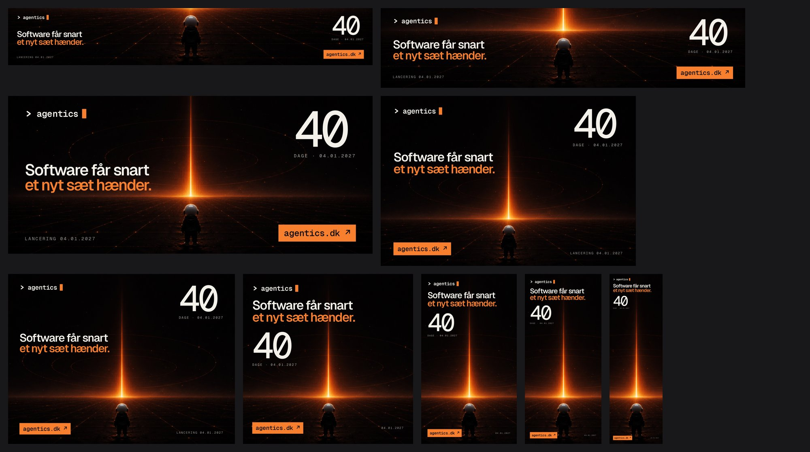

# mockup

**Put your ad campaign on every billboard in town, in seconds, without AI.**

Give it a set of photos where the ad surfaces are green screens, plus your
creatives. You get back photorealistic mockups of your campaign in the wild.
Passers-by stay in front of the screens, the scene's light falls on your ad, and
every format lands on the slot it was made for.



No GPU, no model and no tokens. One Go binary with no native dependencies does
plain geometry and pixel maths. Sixteen 2K mockups take about 3 seconds on a laptop.

| | |
|---|---|
|  |  |
|  |  |
|  |  |

*The example campaign is the launch of [agentics.dk](https://agentics.dk). One
"horizon" series and one countdown week, 9 formats each. All the scenes are
synthetic and unbranded, so you can use them freely.*

## How it works

1. **Scenes.** Each scene is a photo whose ad surfaces are filled with flat chroma
   green (`#00FF00`). You can shoot them yourself or generate them once with any
   image model (the prompts for ours are in [`examples/scenes`](examples/scenes)).
   After that they are reusable forever.
2. **Detect.** `mockup detect` finds each green surface, fits a quad to it (robust
   to strong perspective) and writes a sidecar `scene.surfaces.json`. In that file
   you name each slot's format, and you can pin a corner by hand when someone
   stands across it.
3. **Render.** Each creative is warped into its slot with a homography. The key
   colour's brightness becomes the ad's shading, so lighting gradients and shadows
   carry over. The soft matte keeps people, hair and poles in front. Green spill is
   removed, and screens get a little bloom and sensor grain so the ad doesn't look
   pasted on.

## Formats, not guesses

Real out-of-home media has a spec per format: a bus-shelter screen is 1080×1920, a
rooftop LED might be 3840×840. Squeezing one poster into every slot either crops
your headline or letterboxes it. That's why the series file starts with a
**delivery spec**:

```yaml
formats:
  strip:     { size: 3840x600,  description: "Long illuminated wall" }
  rooftop:   { size: 3840x840,  description: "Rooftop LED" }
  billboard: { size: 2400x1600, description: "3:2 billboard / building wrap" }
  board:     { size: 2400x1800, description: "4:3 megaboard / metro panel" }
  mupi:      { size: 1080x1920, description: "Bus shelter / street screen" }
  banner:    { size: 1000x3200, description: "Hanging fabric banner" }
  # …

scenes:
  - scenes/*.png
  - path: scenes/rooftop-led.png
    finish: led            # print | backlit (default) | led

series:                    # e.g. one per campaign week
  - name: week-40
    ads:
      strip: creatives/week-40/strip.jpg
      mupi:  creatives/week-40/mupi.jpg
      # … one creative per format

output: out
```

`mockup formats` reads the scenes and tells the designer exactly what to deliver,
and what is still missing:

```
$ mockup formats series.yaml
Delivery spec — one creative per format, per series:

  FORMAT       SIZE        RATIO  SLOTS
  banner       1000x3200   1:3.2  3  scaffold-wrap, station-hall ×2
  billboard    2400x1600   1.5:1  5  megaboard-night ×2, scaffold-wrap, station-hall ×2
  board        2400x1800   1.3:1  4  megaboard-night, metro-wall ×3
  mupi         1080x1920   1:1.8  13 airport-wall, bus-shelter ×2, megaboard-night ×3, …
  …
All 2 series deliver every format. Ready to render.
```

`mockup render` refuses to run while a format is missing or a creative has the
wrong aspect, so a headline is never silently cropped. If you want it to proceed
anyway, set `fit: contain` (pad with the creative's edge colour) or `fit: cover`.



## Usage

```sh
go install github.com/pksorensen/pks-agent-mockup/cmd/mockup@latest

mockup detect scenes/*.png          # once per new scene; then name each slot's format in the sidecar
mockup formats series.yaml --assign # suggest formats for unnamed slots from their shape (check them!)
mockup formats series.yaml          # the delivery spec
mockup render series.yaml           # out/<series>/<scene>.jpg + out/index.html contact sheet
```

To try it on the bundled example:

```sh
git clone https://github.com/pksorensen/pks-agent-mockup && cd pks-agent-mockup
go run ./cmd/mockup render examples/series.yaml && open out/index.html
```

### Sidecar reference

```json
{
  "finish": "backlit",
  "surfaces": [
    {
      "quad": [{"X":1305,"Y":361},{"X":1619,"Y":377},{"X":1616,"Y":776},{"X":1308,"Y":812}],
      "format": "board",
      "finish": "backlit",
      "fit": ""
    }
  ]
}
```

- `quad` lists the corners clockwise from top-left, in scene pixels.
- `format` names a key under `formats:`. `"off"` leaves a slot dark, like a
  switched-off screen.
- `finish` is one of the following. `print` takes the scene's light fully.
  `backlit` makes its own light and keeps a hint of the scene's shading. `led` is
  emissive, with bloom.
- `aspect` overrides the slot's real width/height. Normally it comes from the format.

### Making your own scenes

Any photo with flat green surfaces works. If you generate them, the part of the
prompt that matters is:

> every advertising surface in the scene is a blank chroma-key screen: the whole
> display area is filled edge to edge with flat, uniform, pure chroma green
> (#00FF00), no text, no image, no logo, no pattern, crisp straight edges with its
> real frame/bezel around it. Nothing else in the image is green of that hue.

Keep scenes as PNG. JPEG artefacts on the key edges create phantom surfaces.

## Honest use

These are mockups. Use them to pitch, plan and preview campaigns. Don't present
them as media you have actually bought.

## License

MIT
